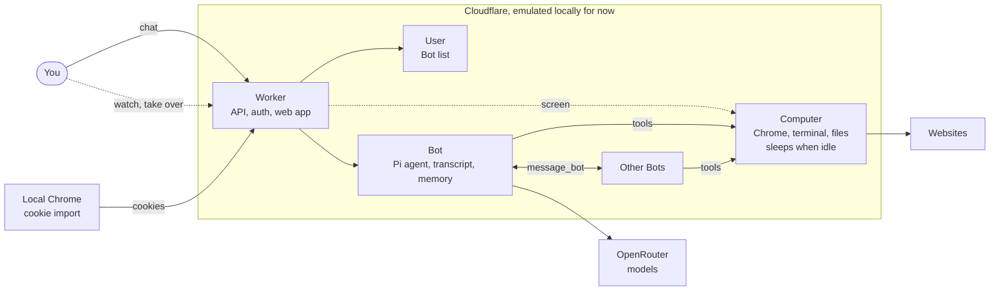

# flarebot

Always-on AI teammates that run on Cloudflare. You message a Bot like a coworker, and it works on a Linux computer with Chrome that you can watch and take over.

Inspired by the UX of [Grok Bot](https://docs.x.ai/grok-bot/overview).

**Status:** working locally, not deployed.

## Features

| Feature | Status |
| --- | --- |
| Named Bots with chat, steering and stop | Built |
| Memory managed through chat, and a model picker | Built |
| Bots messaging each other, with automatic replies | Built |
| Linux desktop: commands, screenshots, clicks, typing | Built |
| Live preview, take over, hand back | Built |
| Sleep when idle, restore from a snapshot | Built |
| Import cookies from local Chrome | Built |
| Approvals, permissions, Secure Form, action log | Planned |
| Skills, routines, dry run | Planned |
| Connected apps, MCP, Vault, control of your Mac | Planned |
| Group chats, push notifications, voice | Planned |

## Quick start

You need [Bun](https://bun.sh), Docker or OrbStack, and `sec` access to Infisical.

```sh
bun install --ignore-scripts
bun run dev
```

Open http://127.0.0.1:8787. The first run builds the computer image, which takes a few minutes.

## Commands

| Command | What it does |
| --- | --- |
| `bun run dev` | Start the app and computer locally |
| `bun run typecheck` | Check types |
| `bun run build` | Build for production |
| `bun scripts/import-chrome-cookies.ts` | Copy local Chrome logins to the computer |

Read [Cookie import](docs/architecture.md#cookie-import) before importing. Every Bot can use imported logins.

## How it fits together



- **Bot:** holds the conversation and memory, and runs the agent loop.
- **Computer:** a disposable Linux container, shared by all Bots, that sleeps when idle.
- **User:** holds the Bot list.

## Docs

| Doc | Read it for |
| --- | --- |
| [Architecture](docs/architecture.md) | How it works, and known limits |
| [Roadmap](docs/roadmap.md) | What's next, costs, open decisions |
| [Grok Bot UX](docs/research/grok-bot-ux.md) | The experience flarebot is based on |
| [How Grok Bot works](docs/research/how-grok-bot-works.md) | Grok Bot's internals, from docs and captured traffic |
| [Target diagram](docs/overview.html) | The planned system, including parts not built yet |
| [UI mock](docs/research/ui-mock.html) | The planned features, in an earlier visual style |
| [AGENTS.md](AGENTS.md) | Instructions for coding agents |
