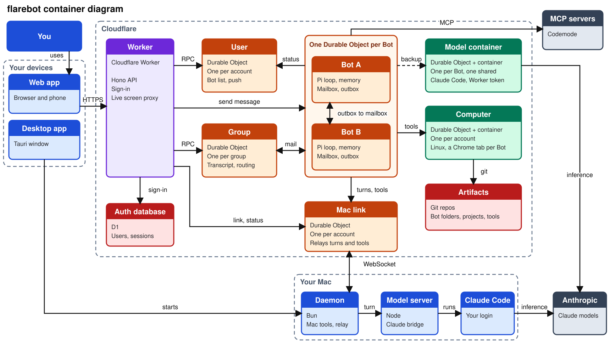

# flarebot

Always-on AI teammates that run on Cloudflare. You message a Bot like a coworker, and it works in its own Chrome tab on a shared Linux computer that you can watch and take over.

Each Bot is a separate bubble: its own role, tab, folder, skills, CLIs, memory and model. All Bots share one computer and one Chrome, so logins are shared. Bots share knowledge only by messages, which go through a durable queue in each Bot.

Inspired by the UX of [Grok Bot](https://docs.x.ai/grok-bot/overview).

**Status:** deployed. The sign-in protection is tested live, but Bots and the computer are only tested locally.

## Features

| Feature | Status |
| --- | --- |
| Named Bots with a role, chat, steering and stop | Built |
| Memory managed through chat, and a model picker | Built |
| One shared computer and Chrome, with a window and folder per Bot | Built, tab control tested locally |
| Threads per Bot: start, switch, stop and close | Built, start and close tested locally |
| Each Bot's folder is a clone of its own Cloudflare Artifacts repo, shared by all its threads and auto-saved when the Bot goes idle | Built, clone and auto-save tested locally |
| Projects: shared Artifacts repos any Bot can start a thread in, on its own branch | Built, clone tested locally |
| Edit and delete Bots, rename and delete groups, from a right-click menu | Built, tested locally |
| Bots messaging each other through a durable queue, with retries and automatic replies | Built, not yet run with a model |
| Group chats of 2 to 6 Bots, with `@` mentions and `@everyone` | Built, not yet run with a model |
| Commands, plus screenshots, clicks, typing, keys and scrolling in the Bot's tab | Built |
| Live preview, take over, hand back | Built |
| Sleep when idle, restore from a snapshot | Built |
| Import cookies from local Chrome | Built |
| Email code sign-in for allowed emails | Built |
| Installable mobile app (PWA) with an iOS Messages style phone layout | Built, tested at phone size locally |
| Approvals, permissions, Secure Form, action log | Planned |
| Skills and CLIs that each Bot creates and downloads for itself | Built, not yet run by a Bot |
| Routines, dry run | Planned |
| Remote MCP servers, added once and switched on per Bot | Built, connect and tool call tested locally |
| One shared pool of CLIs and Agent Skills in Artifacts, ticked per Bot | Built, add, tick and remove tested locally |
| Bots write their own CLIs in any language and skills, and publish them to the pool | Built, a Bot has published a Go CLI; skill publishing not yet run by a Bot |
| Your own Mac as native Bot tools, through the `flarebot-local` daemon, with allowed folders and an approval dialog per action | Built, run by a Bot on live |
| One-line Mac install with a LaunchAgent, a folder picker and browser approval instead of pairing codes | Built, link flow and daemon tested locally |
| Connected apps, MCP OAuth sign-in, Vault | Planned |
| Push notifications, voice | Planned |

## Quick start

You need [Bun](https://bun.sh), Docker or OrbStack, `sec` access to Infisical, and `wrangler login` for the remote Artifacts binding.

```sh
bun install --ignore-scripts
bun run dev
```

Open http://127.0.0.1:8787. The first run builds the computer image, which takes a few minutes.

## Commands

| Command | What it does |
| --- | --- |
| `bun run dev` | Start the app and computer locally |
| `bun run typecheck` | Check types |
| `bun run build` | Build for production |
| `scripts/deploy.sh` | Deploy, including migrations and secrets |
| `bun scripts/import-chrome-cookies.ts` | Copy local Chrome logins to the computer |
| `bun scripts/add-cli.ts --file <path> [--name <name>] [--description <text>]` | Add a Linux `amd64` CLI to the shared pool, then tick it per Bot in Details |
| `curl -fsSL <app url>/mac/install.sh \| sh` | Connect this Mac: installs the daemon, then asks for a folder and opens the browser to approve |
| `bun scripts/add-skill.ts --path <skill folder or SKILL.md>` | Add an Agent Skill to the shared pool, then tick it per Bot in Details |
| `bun scripts/install-on-computer.ts --file <path> --to /workspace/bots/<id>/<path>` | Copy a CLI or skill to a Bot's folder. Add `--executable` for a CLI |

Read [Cookie import](docs/architecture.md#cookie-import) before importing. Every Bot can use imported logins.

## How it works



- **Bot:** a Durable Object with its own role, memory, threads and inbox. It runs the agent loop on OpenRouter models.
- **Threads:** each thread is a new conversation, in the Bot's own folder or in a project.
- **Projects:** shared Artifacts repos. A Bot works in a project on its own branch, `flarebot/<Bot repo>`.
- **Messages:** any Bot can message any other Bot through that Bot's inbox, and the answer comes back the same way.
- **Folder:** `/workspace/bots/<Bot ID>` on the shared computer, a git clone of the Bot's own Cloudflare Artifacts repo, auto-saved when the Bot goes idle.
- **Computer:** one Linux container shared by all Bots, with one Chrome and a window per Bot, that sleeps when idle.

[Architecture](docs/architecture.md) has the details.

## Docs

| Doc | Read it for |
| --- | --- |
| [Architecture](docs/architecture.md) | How it works, and known limits |
| [Roadmap](docs/roadmap.md) | What's next, costs, open decisions |
| [Grok Bot UX](docs/research/grok-bot-ux.md) | The experience flarebot is based on |
| [How Grok Bot works](docs/research/how-grok-bot-works.md) | Grok Bot's internals, from docs and captured traffic |
| [Architecture diagram](docs/architecture.html) | The system, with CDP browser control and one tab per Bot marked as new |
| [Target diagram](docs/overview.html) | The planned system, including parts not built yet |
| [UI mock](docs/research/ui-mock.html) | The planned features, in an earlier visual style |
| [AGENTS.md](AGENTS.md) | Instructions for coding agents |
